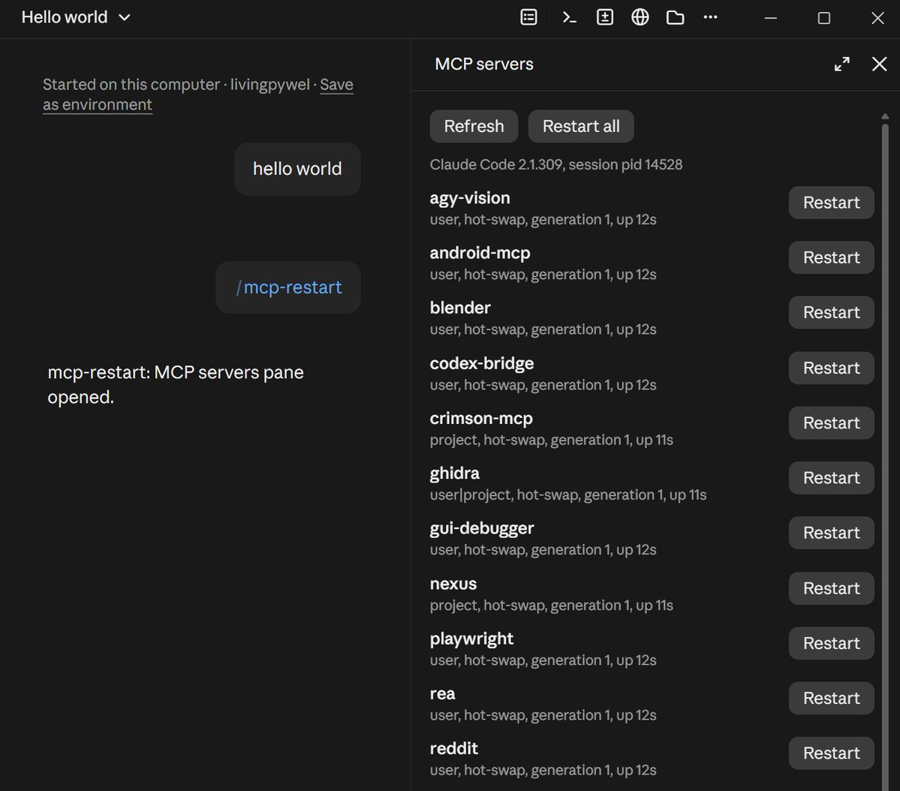

# mcp-restart

Restart MCP servers in a running Claude Code session, the desktop app included, which has no way to do it. A server wrapped by mcp-restart is **hot-swapped**: the new version starts beside the old one and takes over once it answers, a broken version leaves the old one serving, and new or changed tools reach the model at once, in the same session.

And use **MCP servers added after the session started** (`claude mcp add`) in that session: mcp-restart runs them for it and offers their tools as its own, `mcp__mcp-restart__<server>__<tool>`, without a new session.

**Windows only for now.** Tested with Claude Code 2.1.309 in the Claude desktop app and the CLI on Windows 11.



*`/mcp-restart` in the Claude desktop app: every server of the session runs behind the proxy (hot-swap), each with its own Restart.*

## Why

What a Claude Code session does with a stdio MCP server, observed with 2.1.309:

- The desktop app has no Reconnect or Restart for a connected server ([anthropics/claude-code#105049](https://github.com/anthropics/claude-code/issues/105049)); `/mcp reconnect` and `/reload-plugins` say they are not available in its sessions.
- When a server's process dies, the next call starts it again, but the session keeps the tool list it read at its start ([#88483](https://github.com/anthropics/claude-code/issues/88483)): tools an update adds, renames or removes stay wrong until a new session.
- If that new start fails, the server stays unusable for the rest of the session, even after the bug is fixed.
- `notifications/tools/list_changed` is honoured, mid-turn, but only on the connection the session made at its start, and only from a server that said `tools.listChanged: true` at initialize.

So mcp-restart puts a small proxy between the session and each server. The session's connection to the proxy never breaks; the proxy runs the server as its child and swaps it.

## What you get

- **Servers added mid-session work in that session.** A user- or local-scope server added to the config after the session started is started by mcp-restart for the session within about two seconds; its tools are offered as `mcp__mcp-restart__<server>__<tool>` (behind tool search, like any MCP server's), and `call_tool {server, tool_name, arguments}` reaches them in the very turn the server was added. `list_servers`, `restart_server`, the pane and the hang watchdog cover them too; a server removed from the config is stopped, and one whose config changed restarts.
- **Claude restarts servers on its own.** Two tools, `mcp__mcp-restart__restart_server` (a name, several, `stale` or `all`; `force` for a hung server) and `mcp__mcp-restart__list_servers`. Their descriptions tell Claude to restart after it installs, updates or rebuilds anything a server runs, and when a server's calls fail or hang, then retry once.
- **A pane in the desktop app.** `/mcp-restart` lists this session's stdio servers with their mode (hot-swap or stop only), uptime, **stale** (its files changed after it started) and the calls they are running, with Restart, Force restart, Restart stale and Restart all.
- **A hang watchdog.** While a call hangs, Claude cannot do anything; after 60 s a band above the prompt offers **Restart <server> (interrupts the call)**.
- **Commands:** `/mcp-restart <name|stale|all> [--force]`, `/mcp-restart wrap <names|all>`, `/mcp-restart unwrap <names|all>`.

## Install

Needs Node 22 or later on PATH.

At the prompt of a terminal session:

```
/plugin install mcp-restart --marketplace X-15/mcp-restart
```

From a shell:

```bash
claude plugin install mcp-restart --marketplace X-15/mcp-restart
```

In the desktop app, where `/plugin` does not run: click + next to the prompt box, then Plugins, Add marketplace with `X-15/mcp-restart`, then Add plugin.

Then wrap your servers, once (it rewrites your MCP config; new sessions start the servers through the proxy):

```
/mcp-restart wrap all
```

A session started before that keeps running its servers unwrapped: there a restart stops the server and Claude Code starts it on its next call, with the old tool list. Start a new session to hot-swap.

## How it works

- **Restart (swap).** The proxy starts the new server and replays the session's `initialize` to it. Only when that answered does it send new calls there; the old server finishes the calls it has (30 s at most) and is stopped; then the proxy sends `tools/list_changed`, so the session reads the tools again. A new version that fails to start is stopped and the old one keeps serving; the error and the server's stderr come back.
- **Force.** The old server's calls in flight end with an error ("interrupted by a restart") instead of finishing: what frees a hung call.
- **Crash.** Calls in flight get an error; the next call starts the server again, and again after a fix. Never stuck.
- **Transparent.** Every message passes through unchanged, both ways: progress, logging, cancellation, the server's own `list_changed`. Requests the server sends the client (roots, sampling, elicitation) get ids of the proxy's own, so two generations never mix up answers. The one change: the `initialize` answer says `tools.listChanged: true`.
- **Control.** Each proxy listens on `\\.\pipe\mcp-restart-<proxy pid>` for `{"op":"status"}` and `{"op":"restart","force":false}`. The proxy tells its server `MCP_RESTART_PROXY_PID`.
- **Finding servers.** A session is a Claude Code `claude.exe` (not the desktop app's own Electron processes). Its servers are its child processes whose command line holds a configured server's command and arguments; configs are read from `~/.claude.json` (user and local scope), every known project's `.mcp.json`, and installed plugins.
- **Stale.** A file the server runs changed after it started: its script or executable, `node_modules\.package-lock.json`, a venv's `Lib\site-packages`, a `uv --directory` project's `uv.lock`. Servers run by `npx` or `uvx` have no local files to compare.
- **Servers added mid-session.** A session reads its MCP config once, at its start, and the desktop app cannot add a server to a running session. A mod can declare tools at any time (`$.tool.register`) but cannot speak stdio MCP itself (`$.process.spawn` writes a child's stdin once), so the mod starts `late-host.mjs` for the session's life. The host polls `~/.claude.json`, runs every user-scope server and every local-scope server of the session's folder that the session did not start (less those turned off for the folder; never a project `.mcp.json` server, which waits for the person's approval), as an MCP client over stdio or streamable HTTP, and reports each one's tools on stdout. The mod registers them and forwards the model's calls to the host's loopback HTTP endpoint (127.0.0.1, a random port, a token per run); a call longer than 25 s is fetched again by id, so no request waits long. Which servers the session started itself is worked out once per session: everything configured, for a session under a minute old; for one the plugin loads into later (an install, `/reload-plugins`), the servers it has tools from or runs a process for, so a server added before that load is served too. A wrapped config runs the server behind the proxy directly; a restart starts the new version first and keeps the old one when the new one fails. The host ends with the session, its servers with it (they lose their stdin).
- **Wrapping.** `wrap` rewrites a server's config to `node <proxy> --name <name> -- <command> <args>`, keeping its env. User and local scope go through `claude mcp remove` and `claude mcp add-json` (running sessions write `~/.claude.json` too); project `.mcp.json` files are edited in place. Each changed file is backed up once per run as `<file>.mcp-restart-<time>.bak`. A server whose program is not on this machine (a config from someone else's repository) is left alone. Installed from the marketplace, configs point at `~/.claude/mcp-restart/proxy.mjs`, a copy kept in step with the plugin, because the plugin's own folder changes with every version.

## Limits

- Windows only: finding and stopping a session's servers uses PowerShell (CIM) and `taskkill`. The proxy itself is plain Node.
- A session started before a server was wrapped runs it unwrapped until the next session.
- Desktop extensions (run by the Claude app itself) and HTTP servers are not covered.
- A server that can run only once at a time (an exclusive lock on a file or project) cannot overlap two versions: its swap is stop-then-start, calls during the start wait in the proxy, and there is no old version to fall back to.
- A server's first start, when the session begins, is still bounded by Claude Code's connect timeout (30 s by default, `MCP_TIMEOUT`). Later swaps use the proxy's `--start-timeout` (120 s by default).
- Each wrapped server costs one more Node process, about 16 MB of private memory.
- A server added mid-session is reached under mcp-restart's name (`mcp__mcp-restart__<server>__<tool>`, cut to 64 characters with a hash when longer); from the next session on it is the session's own again (`mcp__<server>__<tool>`). Its results reach the model as text: an image or audio block is named, not shown. An argument named `tool`, `tool_use_id` or `consent` is offered as `<name>_arg` (a tool call's own keys). A tool name stays registered until the session ends (there is no unregister); calling one its server no longer offers says so.
- An HTTP server added mid-session is reached without OAuth (a sign-in needs a new session) and without the stream a server opens by itself (its `list_changed` is not heard there); the legacy SSE transport is not served.
- This works around how Claude Code behaves today. If Claude Code gets a native restart for connected servers, use that.

## Undo

```
/mcp-restart unwrap all
```

or restore a `.mcp-restart-<time>.bak` beside the changed file.

## Tests

```bash
node test/proxy.test.mjs
node test/late-host.test.mjs
```

```bash
claude plugin test .
```

`test/proxy.test.mjs` drives the proxy as Claude Code does, against `test/fixture-server.mjs` (a server whose version, tools, hangs, crashes and slow starts are set in a file): 15 cases from the handshake to a server restarting itself. `test/late-host.test.mjs` drives the host for servers added mid-session as the mod does, against a temporary `~/.claude.json`: 15 cases, from a server added to the config to one removed, a restart with a new tool set, a failed restart, a crash, local scope, the baseline, and no server left running once the host is killed. `tests/*.test.tsx` (`claude plugin test .`) hold the mod: the pane, the band, the tools, and the late servers' tools, calls, names and restarts. `test/verify-wrapped.mjs` starts each configured server plain and wrapped and compares the tools they list, before you wrap anything.

## Without the desktop app's mods

`server.mjs` is the same two tools as a plain stdio MCP server, for a Claude Code without mod support: `claude mcp add mcp-restart -- node <this folder>\server.mjs`.

## License

MIT
